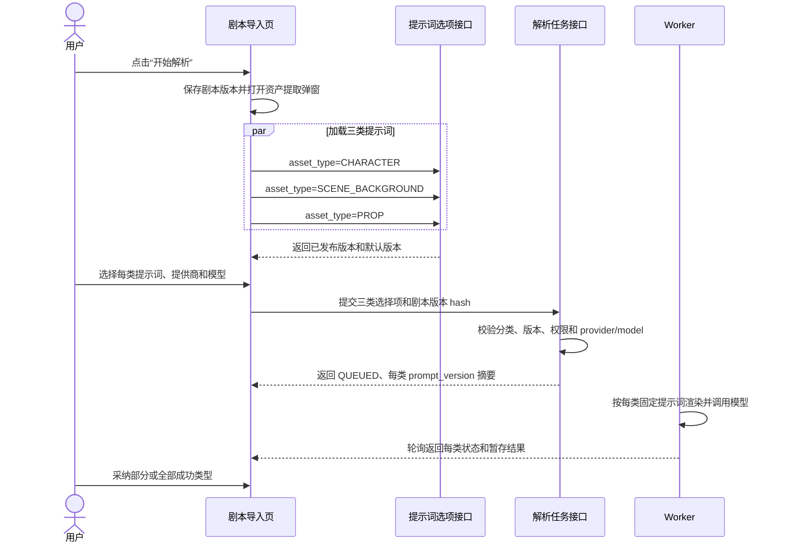

# 剧本资产提取提示词选择设计

## 1. 文档信息

| 项目 | 内容 |
| --- | --- |
| 状态 | 设计提案，待产品和后端评审 |
| 适用范围 | 剧本导入页面“提取剧本资产”弹窗 |
| 关联模块 | 提示词管理、AI 模型提供商、剧本资产解析任务、任务中心 |
| 目标版本 | 在现有异步 `SCRIPT_ANALYSIS` 流程上增量演进 |
| 数据库迁移 | 不在本文范围内；本文只定义逻辑字段和约束 |

本文解决的问题是：当前资产提取弹窗可以为角色、场景、道具分别选择模型提供商和模型，但三类资产实际共用一个 `script_analysis` 提示词。用户需要能按资产类型选择不同的已发布提示词，例如角色提取提示词、场景提取提示词和道具提取提示词，并且任务执行、结果审计和后续重放都能确定地知道当时使用了哪个提示词版本。

本文不重新设计模型提供商配置、任务队列、资产采纳规则或提示词编辑器的完整生命周期；这些能力分别沿用现有实现和以下文档：

- `docs/AI_PROMPT_MANAGEMENT_DESIGN.md`
- `docs/SCRIPT_IMPORT_ANALYSIS_FLOW.md`
- `docs/SCRIPT_ASSET_EXTRACTION_CONCURRENCY_DESIGN.md`

## 2. 一页决策摘要

| 决策 | 结论 |
| --- | --- |
| 选择粒度 | 每个资产类型独立选择一个提示词版本、提供商和模型 |
| 选择对象 | 只能选择 `PUBLISHED` 且对当前项目可见的提示词版本；不能选择草稿、评审中或已停用定义 |
| 分类方式 | `PromptDefinition` 增加服务端受控的 `category`；前端按资产类型过滤，不允许用户输入任意分类字符串 |
| 首期分类 | `SCRIPT_GENERAL`、`SCRIPT_CHARACTER`、`SCRIPT_SCENE`、`SCRIPT_PROP`、`CHARACTER_ENRICHMENT` |
| 首期默认映射 | `CHARACTER -> SCRIPT_CHARACTER`、`SCENE_BACKGROUND -> SCRIPT_SCENE`、`PROP -> SCRIPT_PROP`；未配置时回退到兼容用的 `script_analysis` |
| 版本固定 | 提交任务时固定每个资产类型的 `prompt_version_id`、`prompt_key`、`category`、`content_hash` 和输出 schema 版本 |
| 任务结果 | 仍只进入 `ScriptAnalysisResult` 暂存区，提示词选择不改变“用户采纳后才写入资产库”的规则 |
| 旧客户端兼容 | 未提交提示词版本 ID 时，服务端按资产类型解析默认已发布提示词；新前端始终显式提交版本 ID |
| 安全边界 | 选项接口只返回版本元数据，不返回模板正文、变量内容、API Key 或上游响应 |
| 发布规则 | 同一提示词 key、作用域、语言仍只能有一个主发布版本；发布后版本不可修改 |

## 3. 现状与问题

### 3.1 当前页面行为

`frontend/app/pages/graph/script.vue` 的弹窗已经有三行资产配置：

- `SCENE_BACKGROUND`：场景提取
- `CHARACTER`：角色提取
- `PROP`：道具提取

每行目前可以选择 `provider_config_id` 和 `model`。提交时分别发送：

```text
character_provider_config_id / character_model
scene_background_provider_config_id / scene_background_model
prop_provider_config_id / prop_model
```

页面没有提示词选择，也没有加载提示词选项的请求。

### 3.2 当前服务行为

`ScriptAnalysisTaskService.submit` 在创建任务时只解析一次：

```text
promptCatalog.resolve("script_analysis", projectId, userId, "zh-CN")
```

任务的 `inputPayload` 只保存一个顶层 `prompt_key`、`prompt_version_id` 和 `template_hash`。Worker 再把同一个提示词版本传给每个资产类型的 `ScriptAssetAnalysisService.analyze`。

现有 `PromptCatalogService.REGISTERED_KEYS` 只有 `script_analysis` 和 `character_enrichment`。因此，即使管理端创建了多个提示词定义，资产提取任务也无法按角色、场景、道具使用不同提示词。

### 3.3 本次改造要解决的具体问题

1. 用户能在每种资产行选择适用分类下的提示词。
2. 选项只包含可执行的已发布版本，避免将草稿直接带入线上任务。
3. 后端验证提示词分类与资产类型匹配，不能通过篡改请求让角色任务使用场景提示词。
4. 一个任务中的不同资产类型可以使用不同提示词和不同模型。
5. 任务详情、审计和失败重试可以还原当时的选择，不受后来发布新版本影响。
6. 老版本前端仍能提交任务，不因为没有提示词字段而立即失效。

## 4. 目标与非目标

### 4.1 目标

- 为剧本资产提取增加按类型选择提示词的能力。
- 建立受控分类和资产类型到分类的服务端映射。
- 增加一个面向弹窗的提示词选项查询接口。
- 将每类提示词版本纳入幂等指纹、任务输入元数据和运行审计。
- 保留现有异步执行、部分成功、结果暂存、采纳幂等和剧本版本校验。
- 让提示词管理页面能创建、筛选和识别分类正确的提示词。

### 4.2 非目标

- 不允许用户在弹窗中直接编辑或输入任意提示词文本。
- 不在前端调用模型提供商，也不把 API Key 暴露给前端。
- 不改变角色、场景、道具结果的字段白名单和资产采纳策略；如需改变输出字段，必须另行升级输出 schema。
- 不把一个弹窗配置拆成多个独立顶层任务；一次提交仍是一个 `SCRIPT_ANALYSIS` 父任务。
- 不自动把角色提取结果转换为角色扩写任务；`character_enrichment` 仍是角色页面手动触发的独立场景。
- 不在本文创建或修改数据库迁移脚本。

## 5. 提示词分类模型

### 5.1 分类枚举

分类是服务端注册表中的稳定代码，不是自由文本。首期定义如下：

| `category` | 展示名称 | 适用场景 | 允许的 `asset_type` |
| --- | --- | --- | --- |
| `SCRIPT_GENERAL` | 剧本通用分析 | 兼容现有完整剧本分析或未细分的旧任务 | 仅旧任务/通用解析 |
| `SCRIPT_CHARACTER` | 角色提取 | 从剧本中提取角色资料 | `CHARACTER` |
| `SCRIPT_SCENE` | 场景提取 | 提取地点、时间、天气、光线和视觉信息 | `SCENE_BACKGROUND` |
| `SCRIPT_PROP` | 道具提取 | 提取道具、持有人、功能和连续性信息 | `PROP` |
| `CHARACTER_ENRICHMENT` | 角色内容丰富 | 对已有角色卡做扩写 | 不属于本弹窗 |

分类和提示词 key 的关系：

- `category` 描述业务用途，供筛选、权限和契约校验使用。
- `key` 标识一个可版本化的提示词定义，保持稳定，不因发布新版本变化。
- 同一分类可以有多个 key，例如同为 `SCRIPT_CHARACTER` 的“写实角色提取”和“古风角色提取”。
- 一个提示词定义只能属于一个分类，不能通过一个 key 同时声明角色和场景用途。

### 5.2 推荐内置 key

| `key` | `category` | 用途 | 兼容策略 |
| --- | --- | --- | --- |
| `script_analysis` | `SCRIPT_GENERAL` | 现有通用资产解析 | 旧客户端无提示词字段时作为最终回退 |
| `script_character_extraction` | `SCRIPT_CHARACTER` | 默认角色提取 | 首期内置全局发布版本 |
| `script_scene_extraction` | `SCRIPT_SCENE` | 默认场景提取 | 首期内置全局发布版本 |
| `script_prop_extraction` | `SCRIPT_PROP` | 默认道具提取 | 首期内置全局发布版本 |
| `character_enrichment` | `CHARACTER_ENRICHMENT` | 角色内容丰富 | 沿用现有角色页面任务 |

新建提示词仍必须经过服务端注册表登记。管理端不能仅凭输入一个字符串 key 就使其成为可执行场景。

### 5.3 资产类型映射

服务端维护唯一映射：

```text
CHARACTER         -> SCRIPT_CHARACTER
SCENE_BACKGROUND  -> SCRIPT_SCENE
PROP              -> SCRIPT_PROP
```

前端可以展示中文名称，但不能自行决定分类映射。任务提交、选项查询、Worker 执行和结果校验都必须使用同一份服务端注册表。

### 5.4 默认提示词规则

默认选择用于打开弹窗时填充下拉框，不代表绕过版本固定：

1. 先按当前项目、用户、语言和资产类型查找可见的 `PUBLISHED` 项目级提示词。
2. 如果项目级定义标记为该分类默认项，优先使用它。
3. 否则查找全局分类默认项。
4. 如果新分类尚未部署内置版本，暂时回退到 `script_analysis` 的已发布版本，并在选项响应中返回 `fallback=true` 和 `fallback_reason=LEGACY_GENERAL_PROMPT`。
5. 找不到任何可执行版本时，该资产行不能提交；前端应显示“暂无可用提示词”，而不是静默发送空值。

同一作用域、分类和语言只能有一个默认项。发现多个默认项时，服务端返回配置冲突，不能按 ID 或更新时间随机选择。

## 6. 逻辑数据模型

### 6.1 `PromptDefinition` 扩展

现有 `PromptDefinition` 增加以下逻辑字段；具体列名和数据库实现另行评审：

| 字段 | 类型 | 说明 |
| --- | --- | --- |
| `category` | enum/string | 受控分类代码，必填 |
| `is_category_default` | boolean | 是否为当前作用域和语言的分类默认项；唯一性由服务层保证 |

现有 `key`、作用域、项目、拥有者、启用状态和版本关系保持不变。若实现选择不新增 `is_category_default` 列，也可以由注册表维护默认 key，但不能同时采用两套规则。

### 6.2 `PromptVersion` 约束

`PromptVersion` 继续承载不可变的消息模板、变量 schema、输出 schema、生成策略和内容哈希。新增分类后，版本发布前必须通过分类契约校验：

- `SCRIPT_CHARACTER` 必须声明角色提取输入变量和角色输出 schema。
- `SCRIPT_SCENE` 必须声明场景提取输入变量和场景输出 schema。
- `SCRIPT_PROP` 必须声明道具提取输入变量和道具输出 schema。
- 输出 schema 必须能被当前资产解析器规范化为对应数组，不得发布无法被采纳流程消费的结构。

提示词选项接口只返回版本元数据，不返回 `messages`、变量 schema 正文或输出 schema 正文。

### 6.3 任务选择项

`ScriptAnalysisTaskService.ModelSelection` 的逻辑结构扩展为：

```text
asset_type
provider_config_id
model
prompt_version_id
prompt_key
prompt_category
prompt_template_hash
prompt_output_schema_version
selection_source       // EXPLICIT 或 DEFAULT 或 LEGACY_FALLBACK
```

任务的 `ScriptAnalysisResult.selectionsJson` 保存每个资产类型的一份选择项。任务 `inputPayload` 保存供列表和审计使用的白名单元数据，不保存完整渲染消息或完整剧本文本。

推荐的 `inputPayload` 结构：

```json
{
  "prompt_selection_mode": "PER_ASSET_TYPE",
  "prompt_selections": [
    {
      "asset_type": "CHARACTER",
      "prompt_key": "script_character_extraction",
      "prompt_category": "SCRIPT_CHARACTER",
      "prompt_version_id": 31,
      "template_hash": "sha256:...",
      "output_schema_version": "script_character_extraction.v1",
      "selection_source": "EXPLICIT",
      "provider_config_id": 12,
      "model": "chat-model-default"
    },
    {
      "asset_type": "SCENE_BACKGROUND",
      "prompt_key": "script_scene_extraction",
      "prompt_category": "SCRIPT_SCENE",
      "prompt_version_id": 34,
      "template_hash": "sha256:...",
      "output_schema_version": "script_scene_extraction.v1",
      "selection_source": "DEFAULT",
      "provider_config_id": 18,
      "model": "scene-model-v2"
    }
  ]
}
```

为兼容既有任务，查询接口可继续返回顶层 `prompt_key`、`prompt_version_id` 和 `template_hash`，但新任务应以 `prompt_selections` 为事实来源；顶层字段仅在所有资产类型使用同一提示词时填充，否则返回 `null`。

## 7. 提示词选项接口

### 7.1 接口

```http
GET /api/ai/prompts/options
  ?project_id=42
  &asset_type=CHARACTER
  &locale=zh-CN
```

所有 HTTP 输入直接声明在控制器方法上，参数使用 snake_case。`project_id` 沿用项目权限校验，`asset_type` 只允许 `CHARACTER`、`SCENE_BACKGROUND`、`PROP`，`locale` 默认 `zh-CN`。

也可以在现有 `GET /api/ai/prompts` 上增加 `category`、`asset_type` 和 `published_only` 参数，但不应让弹窗自己拼接多个目录接口。推荐保留专用 `options` 接口，使返回契约天然面向选择场景。

### 7.2 响应

```json
{
  "asset_type": "CHARACTER",
  "category": "SCRIPT_CHARACTER",
  "locale": "zh-CN",
  "default_version_id": 31,
  "list": [
    {
      "prompt_id": 9,
      "prompt_key": "script_character_extraction",
      "display_name": "默认角色提取",
      "purpose": "提取身份、外貌、性格和关系",
      "scope_type": "GLOBAL",
      "project_id": null,
      "version_id": 31,
      "version_no": 2,
      "status": "PUBLISHED",
      "locale": "zh-CN",
      "content_hash": "sha256:...",
      "output_schema_version": "script_character_extraction.v1",
      "is_default": true,
      "fallback": false,
      "updated_at": "2026-09-06T10:20:00"
    }
  ]
}
```

### 7.3 查询规则

- 只返回 `enabled=true` 的定义和 `PUBLISHED` 版本。
- 只返回当前用户能在该项目中使用的全局、项目或个人作用域版本。
- 按解析优先级排序：项目级覆盖、个人项目个人作用域、全局；同作用域再按默认项、更新时间和版本号排序。
- 请求 locale 优先匹配；无匹配时只回退到定义的 `default_locale`，禁止跨语言随机回退。
- 同一个 `prompt_id` 的多个已发布语言版本可以同时返回，但每个 locale 只返回一个主发布版本。
- 不返回模板消息、变量值、API Key、完整审计信息或任何上游供应商响应。
- 选项读取失败时返回稳定错误码，例如 `PROMPT_OPTIONS_UNAVAILABLE`；前端不能把旧缓存当成当前项目的确定配置，除非缓存包含项目、分类、locale 和版本 hash。

### 7.4 权限

选项接口需要登录。服务端必须同时校验：

1. 用户是否能读取项目。
2. 提示词作用域是否对该用户可见。
3. 版本是否已发布且定义启用。
4. `category` 是否允许用于请求的 `asset_type`。

不能只依赖前端下拉框过滤，也不能仅凭 URL 中的 `project_id` 放行项目级提示词。

## 8. 弹窗交互设计

### 8.1 布局

现有三行配置保留，在提供商和模型控件前增加提示词选择：

```text
┌─ 场景提取 ─────────────────────────────────────────────┐
│ [启用]  提示词 [默认场景提取 v2                 ▼]      │
│         提供商 [OpenAI                         ▼]      │
│         模型   [gpt-4.1-mini                    ▼]      │
│         提示：提取地点、时间、天气、光线和视觉风格       │
└────────────────────────────────────────────────────────┘
```

桌面端可以将提示词、提供商、模型放在同一行，窄屏时纵向排列。每个控件应有稳定宽度，选择版本变化不能导致其他控件跳动。

### 8.2 选择控件

- 使用 `n-select`，支持搜索，选项显示“展示名称 · v版本号 · 作用域”。
- 下拉框只展示已发布版本，不显示草稿和评审中版本。
- 行标题固定为角色、场景、道具，提示词下拉已按行的 `asset_type` 过滤，不再额外让用户选择分类。
- 默认值来自 `default_version_id`；如果是兼容回退，显示提示词名称并附加“通用兼容提示词”状态，不隐藏回退事实。
- 已启用行没有可用提示词时，提示词控件置为错误状态并阻止提交。
- 未启用行可以保留上次选择，但不提交其 prompt/provider/model 参数。
- 提供一个“管理提示词”文本按钮，打开提示词管理页对应分类；它不应在弹窗内打开可编辑模板。

### 8.3 加载与错误状态

| 状态 | 交互 |
| --- | --- |
| 加载中 | 行内显示 skeleton/加载状态，开始提取按钮禁用 |
| 成功 | 填充默认提示词、提供商和模型 |
| 无已发布提示词 | 显示“暂无可用提示词”，提供前往管理页入口，阻止该行提交 |
| 请求失败 | 显示可重试错误，不能自动改用未确认的旧版本 |
| 提示词版本已下线 | 提交前重新校验选项；后端返回冲突时刷新选项并要求重新选择 |
| 任务已提交 | 所有选择控件只读；任务详情显示每种资产的提示词版本摘要 |

### 8.4 前端状态结构

`AnalysisJob` 增加：

```ts
promptVersionId: number | null
promptKey: string
promptCategory: string
promptTemplateHash: string
promptSelectionSource: 'EXPLICIT' | 'DEFAULT' | 'LEGACY_FALLBACK'
```

`analysisJobsValid` 除现有 provider/model 校验外，还要校验启用行的 `promptVersionId > 0`。提交指纹必须包含：

```text
stream | asset_type:provider_config_id:model:prompt_version_id
```

更换提示词版本必须生成新的 `Idempotency-Key`，不能把不同提示词误认为同一个任务请求。

### 8.5 用户流程



## 9. 提交接口变更

### 9.1 新增请求参数

在现有 `POST /api/projects/{project_id}/script/analysis-tasks` 增加三组可选参数：

```text
character_prompt_version_id
scene_background_prompt_version_id
prop_prompt_version_id
```

它们与各自的 provider/model 成对出现：

```text
character_provider_config_id + character_model + character_prompt_version_id
scene_background_provider_config_id + scene_background_model + scene_background_prompt_version_id
prop_provider_config_id + prop_model + prop_prompt_version_id
```

新前端对启用的资产类型始终发送完整三元组。未启用类型不发送任何一项。

### 9.2 服务端校验顺序

1. 校验 `episode_id`、`version_id`、`content_hash` 和项目写权限。
2. 根据 provider/model 参数确定启用的资产类型。
3. 对每个启用类型校验 provider 配置和模型。
4. 如果提交了 prompt version ID：
   - 版本存在且属于有效提示词定义。
   - 定义启用，版本状态为 `PUBLISHED`。
   - 版本语言匹配请求 locale 或定义默认语言。
   - 提示词分类等于服务端映射的目标分类。
   - 当前用户对项目和提示词作用域有使用权限。
   - 版本输出 schema 与资产类型契约兼容。
5. 如果未提交 prompt version ID：按默认规则解析并记录 `DEFAULT` 或 `LEGACY_FALLBACK`。
6. 计算每个选择项的模板 hash 和变量 hash，写入任务元数据。
7. 校验幂等键时必须比较 prompt version ID、template hash、provider、model 和资产类型集合。

任一资产类型校验失败，整个任务不入队，返回 400 或 409；不能让任务进入后再由 Worker 才发现分类不匹配。

### 9.3 推荐响应

```json
{
  "task_id": "1024",
  "status": "QUEUED",
  "asset_types": ["CHARACTER", "SCENE_BACKGROUND"],
  "version_id": 88,
  "prompt_selections": [
    {
      "asset_type": "CHARACTER",
      "prompt_key": "script_character_extraction",
      "prompt_category": "SCRIPT_CHARACTER",
      "prompt_version_id": 31,
      "template_hash": "sha256:...",
      "selection_source": "EXPLICIT"
    },
    {
      "asset_type": "SCENE_BACKGROUND",
      "prompt_key": "script_scene_extraction",
      "prompt_category": "SCRIPT_SCENE",
      "prompt_version_id": 34,
      "template_hash": "sha256:...",
      "selection_source": "DEFAULT"
    }
  ],
  "correlation_id": "c6f2..."
}
```

现有响应字段 `prompt_key`、`prompt_version_id`、`template_hash` 可以保留用于旧前端，但当三类使用不同提示词时应为 `null`，避免制造“任务只有一个提示词”的错误认知。

## 10. Worker 执行设计

### 10.1 任务解析

Worker 从任务创建时保存的 `selectionsJson` 读取每类选择项，不重新按当前默认规则解析。这样发布新提示词不会改变已经排队的任务。

每个选择项执行前：

1. 使用 `prompt_version_id` 读取版本。
2. 允许 `PUBLISHED` 或已被任务引用后归档的版本；其他状态拒绝执行。
3. 比较保存的 `template_hash` 与当前版本 hash；不一致则失败并记录 `PROMPT_VERSION_CHANGED`。
4. 使用该类型对应的变量集合渲染消息。
5. 通过 `PromptInvocationBuilder` 构造调用，仍由 `AiInvocationService` 负责供应商、密钥、超时、重试和限流。
6. 对输出执行该分类的 schema 校验和当前资产类型字段白名单规范化。

### 10.2 `ScriptAssetAnalysisService` 接口

`analyze` 逻辑参数增加 `promptVersionId`、`promptHash` 和可选的 `promptCategory` 校验信息。它不能根据资产类型自行猜测提示词，也不能在任务已有固定版本时重新调用 `resolve("script_analysis")`。

任务执行器应将每类选择项分别传入：

```text
analyze(
  assetType,
  providerConfigId,
  model,
  sourceContent,
  promptVersionId,
  promptHash,
  ...
)
```

### 10.3 结果和审计

现有 `type_results` 增加：

```json
{
  "status": "SUCCEEDED",
  "provider_config_id": 12,
  "model": "chat-model-default",
  "prompt_key": "script_character_extraction",
  "prompt_category": "SCRIPT_CHARACTER",
  "prompt_version_id": 31,
  "prompt_hash": "sha256:...",
  "request_id": "...",
  "items": []
}
```

`PromptRunAudit` 每次调用仍保存 prompt key、版本 ID、模板 hash、变量 hash、渲染输入 hash、模型、提供商配置、耗时和 token 统计，不保存完整渲染消息或变量值。

### 10.4 失败语义

| 错误码 | 触发条件 | 页面行为 |
| --- | --- | --- |
| `PROMPT_VERSION_NOT_FOUND` | 任务引用的版本已被删除或不可读取 | 该类型失败，允许重新提交 |
| `PROMPT_VERSION_CHANGED` | 版本 hash 与任务快照不一致 | 该类型失败，要求重新选择提示词 |
| `PROMPT_CATEGORY_MISMATCH` | 版本分类与资产类型不匹配 | 创建任务阶段直接拒绝 |
| `PROMPT_OUTPUT_SCHEMA_INVALID` | 模型输出不符合该分类契约 | 该类型失败，其他类型可继续 |
| `PROMPT_CONTEXT_TOO_LARGE` | 渲染后超过提示词预算 | 按既有摘要/重试策略处理 |

只要至少一个类型成功，父任务仍可以进入 `SUCCEEDED` 并暂存部分结果；采纳只允许成功且尚未采纳的类型。

## 11. 输出契约设计

### 11.1 统一输入变量

三类剧本资产提示词首期统一支持：

| 变量 | 类型 | 说明 |
| --- | --- | --- |
| `script_content` | string | 服务端读取的剧本正文 |
| `episode_context_json` | string | 剧集 ID、标题和必要上下文 |
| `asset_type` | enum | 当前资产类型；由服务端注入 |
| `output_language` | enum | 当前输出语言 |
| `detail_level` | enum | `STANDARD` 或 `DETAILED` |

模板只能使用声明过的变量。剧本正文必须放在 user 消息的 `<input_data>` 数据区块中，不能成为 system 消息或消息角色的一部分。

### 11.2 分类 schema

每个分类拥有独立 schema 版本：

```text
script_character_extraction.v1
script_scene_extraction.v1
script_prop_extraction.v1
```

为减少解析器改造，首期建议模型返回统一 envelope：

```json
{
  "items": [],
  "warnings": []
}
```

服务端按 `asset_type` 将 `items` 规范化为现有结果字段：

```text
CHARACTER        -> result.characters
SCENE_BACKGROUND -> result.scenes
PROP             -> result.props
```

也可兼容现有 `characters`、`scenes`、`props` 顶层数组，但发布校验必须保证其只包含当前分类字段，避免一条角色提示词返回场景或道具数据。

### 11.3 分类字段建议

| 分类 | 必需字段 | 可选字段 |
| --- | --- | --- |
| `SCRIPT_CHARACTER` | `name` | `identity`、`appearance`、`personality`、`relationships`、`dialogue_intent`、`remarks` |
| `SCRIPT_SCENE` | `name` 或 `location` | `environment_type`、`time`、`weather`、`lighting`、`visual_style`、`plot_purpose`、`actions`、`remarks` |
| `SCRIPT_PROP` | `name` | `category`、`description`、`owner`、`function`、`continuity_notes`、`remarks` |

字段白名单、最大长度、数组上限和空值规则继续由 `PromptSchemaValidator` 及资产解析器执行。提示词管理端不能通过自定义 schema 放宽这些业务上限。

## 12. 提示词管理页面调整

现有 `frontend/app/pages/prompts.vue` 需要增加分类可见性和筛选能力：

- 目录列表增加“分类”列和分类筛选。
- 新建提示词时必须选择分类；分类决定可用的变量/输出 schema 预设和允许的 `asset_type`。
- 详情页展示分类、适用资产类型、默认状态和最近发布版本。
- 发布前校验分类契约，阻止把 `SCRIPT_SCENE` 的输出 schema 用于角色提取。
- 版本编辑器继续允许修改草稿，但发布后不可原地修改。
- 删除、归档、回滚规则沿用现有 `PromptCatalogService`。

管理页可以展示提示词 key 和版本，但不需要为弹窗复制另一套模板编辑功能。弹窗只消费选项接口。

## 13. 兼容、灰度与回滚

### 13.1 兼容旧客户端

分三个阶段发布：

1. **后端兼容阶段**：新增 category 字段、选项接口和提交参数；旧请求缺少 prompt version ID 时按默认规则补齐。
2. **前端切换阶段**：弹窗加载并提交每类 prompt version ID；旧版顶层提示词字段继续返回。
3. **清理阶段**：观察一个版本周期后，停止创建新的 legacy fallback 任务；历史任务和旧参数仍可查询。

旧版数组参数 `asset_types/provider_config_ids/models` 与新版命名参数的兼容规则沿用 `SCRIPT_IMPORT_ANALYSIS_FLOW.md`：新旧参数不能混用，服务端最终转换为同一份选择项。

### 13.2 默认提示词替换

替换默认提示词必须通过新版本发布，不修改已发布版本内容。新任务读取新的默认版本，已创建任务继续使用旧版本。需要回滚时，将历史版本复制为新草稿并按正常评审发布，不能把任务中的版本 ID 改写成当前默认版本。

### 13.3 部分失败

每个类型独立记录 prompt version、provider、model 和错误。一个分类提示词失败不应清除其他类型的成功结果；采纳接口继续按成功类型集合和幂等键执行。

## 14. 安全与可观测性

- 前端只提交提示词版本 ID，不提交模板正文、变量值、API Key 或供应商私有参数。
- 服务端重新加载版本并校验分类、状态、作用域和 hash，不能信任前端显示名称或 key。
- 任务列表和普通任务详情只显示提示词 key、分类、版本号和 hash 摘要；完整模板正文走提示词权限接口。
- 日志和审计增加 `asset_type`、`prompt_key`、`prompt_category`、`prompt_version_id`、`template_hash`，禁止记录完整剧本或渲染后的消息。
- 监控指标按提示词分类、版本、模型和资产类型统计成功率、schema 失败率、P95 延迟、token 和成本。
- 版本归档不影响已经创建的任务；Worker 允许执行被任务引用的归档版本，但仍要求 hash 匹配。

## 15. 实施拆分

### Phase 1：契约和目录

- 增加分类注册表和资产类型映射。
- 为 `PromptDefinition` 增加分类逻辑字段和服务层校验。
- 增加 `GET /api/ai/prompts/options`。
- 内置角色、场景、道具三类默认提示词；保留 `script_analysis` 作为兼容回退。

### Phase 2：任务链路

- 扩展提交参数和 `ModelSelection`。
- 将每类提示词选择写入 `selectionsJson` 和 `inputPayload`。
- Worker 按每类版本渲染、校验和审计。
- 将 prompt version 纳入幂等键校验和任务详情响应。

### Phase 3：前端弹窗

- 为三类资产行增加提示词下拉框。
- 并行加载三类选项，处理默认值、空状态、失败重试和版本下线冲突。
- 更新提交指纹和禁用条件。
- 在任务进度和结果详情中展示各类型提示词版本摘要。

### Phase 4：管理端和验证

- 提示词管理页增加分类字段、筛选和发布前契约校验。
- 增加服务层、控制器、任务序列化和前端交互测试。
- 通过一组固定剧本样本比较通用提示词与分类提示词的结构化通过率、字段完整率和成本。

## 16. 测试与验收标准

### 16.1 后端

- `asset_type` 与 `category` 映射正确；错误映射返回 `PROMPT_CATEGORY_MISMATCH`。
- 草稿、评审中、停用定义和无权限项目提示词不会出现在 options，也不能通过手工请求提交。
- 同一任务可保存三种不同提示词版本，Worker 分别使用正确版本。
- 任务重试不会重新解析默认提示词，不会因默认版本变化而改变输入。
- 同一幂等键但提示词版本不同会被拒绝；同一完整选择重试返回原任务。
- 版本 hash 变化、版本删除或输出 schema 不兼容时按稳定错误码失败。
- 旧请求缺少 prompt version ID 时能按默认规则完成；新旧参数混用仍被拒绝。

### 16.2 前端

- 打开弹窗后能看到角色、场景、道具各自的提示词选项和默认版本。
- 切换资产类型不会显示其他分类的提示词。
- 修改提示词后提交指纹和幂等键变化。
- 没有可用提示词、选项加载失败或 provider/model 未选择时，开始按钮保持禁用并给出明确提示。
- 任务提交后控件只读；轮询结果展示每类提示词版本和模型摘要。
- 采纳流程、取消任务和部分成功行为与现有页面保持一致。

### 16.3 产品验收

- 运营人员可以为角色、场景、道具分别发布至少一个提示词。
- 用户在同一次资产提取中可选择不同提示词、不同提供商和不同模型。
- 发布新版本不会改变已排队任务；新任务默认使用新版本。
- 解析结果仍需用户确认后才写入资产库。
- 任何普通接口、浏览器网络响应和日志都不泄露完整模板、剧本正文或 API Key。

## 17. 待评审问题

1. 分类默认项是存储在 `PromptDefinition.is_category_default`，还是只由注册表维护默认 key；实现必须选择一种并保持唯一来源。

2. 产品是否允许项目管理员创建项目级分类提示词，还是首期只允许全局内置提示词；建议先支持项目级覆盖，以复用现有提示词作用域模型。
   提示词只能由平台管理员进行管理，并且是全局
3. 分类提示词是否需要在界面显示“适用语言”和“预计成本”；建议首期显示语言和版本，成本沿用现有模型配置统计。
   这两个都不需要
4. `SCRIPT_GENERAL` 的 legacy fallback 保留多久；建议至少保留一个前端版本周期，并在监控中单独统计使用量。
   至少保留一个前端版本周期，并在监控中单独统计使用量
5. 是否允许用户在弹窗内选择历史已归档版本；建议不允许新任务选择归档版本，但允许已创建任务继续执行和重放。
   不允许使用旧版本，用户只能使用当前最新版，也只展示当前最新版
## 18. 最终结论

本次需求的最小可行实现是“按资产类型选择已发布提示词版本”，而不是在弹窗中增加一个全局提示词下拉框。分类必须成为服务端契约的一部分，并与资产类型、输出 schema、权限和任务快照绑定。

落地后，角色、场景、道具可以各自使用专门提示词，同时保持现有提供商/模型独立选择、异步任务、结果暂存和人工采纳流程不变。`script_analysis` 作为旧客户端和未部署分类模板时的兼容回退，但不再是新前端的唯一提示词入口。
